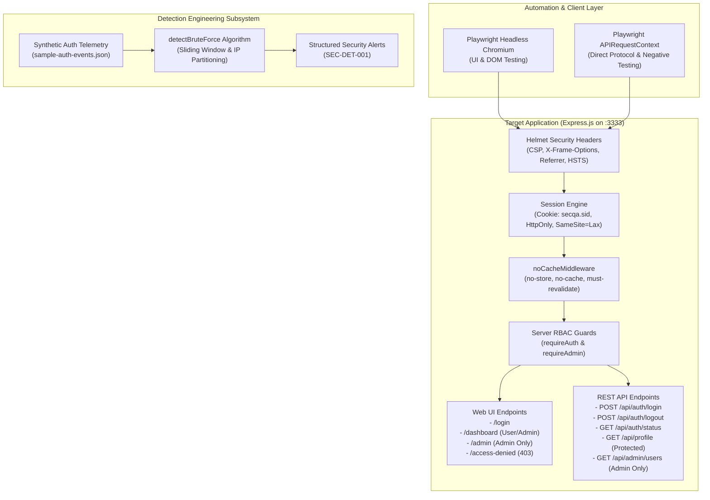
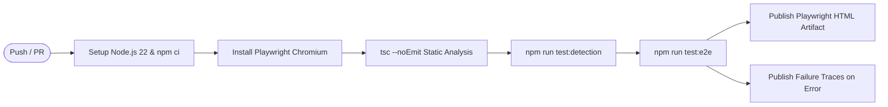

# Playwright Security QA Automation Lab 🛡️

[](https://github.com/altafpasha/playwright-security-qa-lab/actions)
[](https://playwright.dev/)
[](https://nodejs.org/)
[](https://www.typescriptlang.org/)
[](https://owasp.org/www-project-top-ten/)
[](https://opensource.org/licenses/MIT)

> A production-grade portfolio project demonstrating how modern **Application Security (AppSec)** principles integrate directly into **End-to-End QA Automation**, **REST API Contract Verification**, **Detection Engineering**, and **DevSecOps CI/CD Pipelines**.

---

## 📑 Table of Contents

- [Executive Summary](#-executive-summary)
- [Problem Statement & Objectives](#-problem-statement--objectives)
- [System Architecture](#-system-architecture)
- [Technology Stack](#-technology-stack)
- [Synthetic Demo Accounts](#-synthetic-demo-accounts)
- [Installation & Quick Start](#-installation--quick-start)
- [Test Execution Commands](#-test-execution-commands)
- [Test Coverage & OWASP Traceability Matrix](#-test-coverage--owasp-traceability-matrix)
- [Test Results & Verification Status](#-test-results--verification-status)
- [Debugging, Traces & Playwright HTML Reports](#-debugging-traces--playwright-html-reports)
- [Custom Detection Rule (SEC-DET-001)](#-custom-detection-rule-sec-det-001)
- [CI/CD DevSecOps Automation](#-cicd-devsecops-automation)
- [3-to-5 Minute Recruiter Demonstration Script](#-3-to-5-minute-recruiter-demonstration-script)
- [Interview Talking Points & Technical Q&A](#-interview-talking-points--technical-qa)
- [Limitations & Production Hardening Roadmap](#-limitations--production-hardening-roadmap)
- [Publishing to GitHub Guide](#-publishing-to-github-guide)

---

## 🎯 Executive Summary

In enterprise environments, security cannot be an afterthought or an isolated annual audit. Security controls must be verified continuously within automated CI/CD pipelines alongside functional regressions.

This repository demonstrates that unified philosophy:
1. **Target Web Application & REST API (`src/app.ts`)**: A lightweight Node.js/Express application featuring server-side Role-Based Access Control (RBAC), session management, session fixation mitigations, sensitive cache directives, and defense-in-depth HTTP security headers (Helmet).
2. **Playwright Security Test Suites (`tests/`)**: 33 automated tests validating authentication lifecycles, horizontal/vertical privilege escalation defenses, functional UI flows, API schema sanitization, and security header contracts.
3. **Detection Engineering Module (`detection/`)**: A SIEM-like sliding-window detection rule unit-tested with the Node.js built-in test runner (`node:test`), identifying automated brute-force attacks against synthetic authentication telemetry.
4. **DevSecOps GitHub Actions Workflow (`.github/workflows/playwright.yml`)**: Continuous integration pipeline that validates code quality, executes detection unit tests, runs browser suites across headless workers, and publishes test artifacts.

---

## 🛑 Problem Statement & Objectives

Traditional software teams suffer from two common disconnects:
- **Functional QA Engineers** often test only happy paths and basic form validations, lacking the security threat-modeling expertise to verify authorization boundaries, token replay, or cookie scoping.
- **Security Engineers** often run manual black-box scans or point-in-time penetration tests, lacking integration into day-to-day continuous regression test suites.

**Project Objectives:**
- Bridge functional QA with application security verification.
- Enforce the **Principle of Least Privilege (POLP)** using automated negative test cases.
- Validate **OWASP Top 10** categories:
  - **A01:2021 (Broken Access Control)**: Enforce strict server-side RBAC and direct URL navigation blocks.
  - **A02:2021 (Cryptographic & PII Failures)**: Assert sensitive credential fields are stripped from all API outputs.
  - **A05:2021 (Security Misconfiguration)**: Assert CSP, X-Frame-Options, noSniff, and anti-caching directives.
  - **A07:2021 (Identification & Authentication)**: Test user enumeration defenses, session invalidation, and session fixation mitigation.
- Deliver an interview-ready project that any candidate or recruiter can clone, run, and explore within five minutes.

---

## 🏗️ System Architecture



For complete technical diagrams and data flow details, see the [Architecture Documentation](docs/architecture.md).

---

## 💻 Technology Stack

| Component | Technology | Rationale & Justification |
|---|---|---|
| **E2E & API Automation** | [Playwright Test](https://playwright.dev/) (`^1.49.1`) | High-speed parallel execution, isolated browser contexts, built-in network interception, dual UI/API test runner. |
| **Language** | [TypeScript](https://www.typescriptlang.org/) (`^5.7.2`) | Strict type-safety (`strict: true`), autocompletion for DOM/API contracts, and prevention of runtime undefined errors. |
| **Backend Demo Server** | [Express](https://expressjs.com/) (`^4.21.2`) & Node.js (`v22+`) | Lightweight, zero-bundler server allowing direct inspection of headers, cookies, and middleware logic. |
| **Security Middleware** | [Helmet](https://helmetjs.github.io/) (`^8.0.0`) | Standards-compliant HTTP security header injection (CSP, frameguard, noSniff, referrerPolicy). |
| **Session Engine** | [express-session](https://github.com/expressjs/session) (`^1.18.1`) | Real-world cookie-based session tracking with programmatic regeneration to counter session fixation. |
| **Detection Unit Tests** | Node.js Test Runner (`node:test` & `node:assert/strict`) | Built-in zero-dependency testing for high-performance SIEM rule unit testing. |
| **CI/CD Automation** | [GitHub Actions](https://github.com/features/actions) | Industry-standard cloud CI/CD automating linting, detection tests, browser test runs, and artifact publishing. |

---

## 👥 Synthetic Demo Accounts

> [!WARNING]
> **DEVELOPMENT & LAB EVALUATION ONLY**
> These credentials are strictly synthetic demo accounts embedded for portfolio testing. Never reuse these passwords in real environments.

| Role | Email | Password | Allowed Capabilities |
|---|---|---|---|
| **Standard User** | `user@demo.local` | `UserPass123!` | Access `/dashboard`, invoke `/api/profile`, refresh profile inspector. Denied `/admin` and `/api/admin/users`. |
| **Administrator** | `admin@demo.local` | `AdminPass123!` | Access `/dashboard`, `/admin` portal, view complete employee directory table, invoke `/api/admin/users`. |

---

## 🚀 Installation & Quick Start

### Prerequisites
- **Node.js**: `v20.x` or `v22.x` (Tested and verified on Node `v22.23.2`)
- **npm**: `v9.x` or `v10.x`
- **Supported OS**: Linux, macOS, or Windows (WSL recommended)

### Step 1: Clone Repository
```bash
git clone https://github.com/altafpasha/playwright-security-qa-lab.git
cd playwright-security-qa-lab
```

### Step 2: Install Dependencies
```bash
npm install
```

### Step 3: Install Playwright Chromium Browser
```bash
npx playwright install --with-deps chromium
```

### Step 4: Run the Complete Test Suite
```bash
npm test
```

---

## 🧪 Test Execution Commands

The project provides granular npm scripts for both CI pipelines and interactive local development:

```bash
# 1. Run full test suite (Detection unit tests + Playwright E2E)
npm test

# 2. Run only Detection Engineering unit & integration tests
npm run test:detection

# 3. Run all Playwright E2E tests (Headless mode)
npm run test:e2e

# 4. Run targeted Playwright suites
npm run test:auth             # Authentication & session invalidation
npm run test:access-control   # RBAC & privilege escalation defenses
npm run test:functional       # Form validation & UI regression
npm run test:api              # REST API contract & negative injection testing
npm run test:security-headers # CSP, anti-caching, and cookie security flags

# 5. Interactive Playwright UI Mode (Visual step-through debugger)
npm run test:e2e:ui

# 6. Headed browser mode (Watch browser execute live)
npm run test:e2e:headed

# 7. Open latest Playwright HTML Report
npm run test:report

# 8. Typecheck & static analysis
npm run typecheck
```

---

## 📊 Test Coverage & OWASP Traceability Matrix

Every test in this repository maps directly to industry-standard security frameworks and quality assurance disciplines:

| Test ID | Test Suite | Objective & Assertion | Category / Standard |
|---|---|---|---|
| **TC-AUTH-001** | `auth.spec.ts` | Valid standard user login & `secqa.sid` cookie flags verification | OWASP A07:2021 Identification & Auth |
| **TC-AUTH-002** | `auth.spec.ts` | Valid administrator login & admin portal navigation discovery | OWASP A07:2021 Identification & Auth |
| **TC-AUTH-003** | `auth.spec.ts` | Invalid password rejection & confirmation that no session is created | OWASP A07:2021 Identification & Auth |
| **TC-AUTH-004** | `auth.spec.ts` | User enumeration defense: identical generic error for non-existent users | OWASP A07:2021 Identification & Auth |
| **TC-AUTH-005** | `auth.spec.ts` | Client-side required field and format validation | QA Input Integrity |
| **TC-AUTH-006** | `auth.spec.ts` | Clean session destruction and cookie clearing upon user logout | OWASP A07:2021 Session Management |
| **TC-AUTH-007** | `auth.spec.ts` | Direct unauthenticated access to `/dashboard` redirects to `/login` | OWASP A01:2021 Broken Access Control |
| **TC-AUTH-008** | `auth.spec.ts` | Post-logout session invalidation prevents back-button / cookie replay | OWASP A07:2021 Session Fixation / Replay |
| **TC-RBAC-001** | `access-control.spec.ts` | Standard user denied `/admin` UI, returns HTTP 403 Forbidden | OWASP A01:2021 Broken Access Control |
| **TC-RBAC-002** | `access-control.spec.ts` | Standard user denied `/api/admin/users`, returns HTTP 403 Forbidden | OWASP A01:2021 Missing Function Level Access Control |
| **TC-RBAC-003** | `access-control.spec.ts` | Administrator granted full access to `/admin` UI and `/api/admin/users` | Principle of Least Privilege (POLP) |
| **TC-RBAC-004** | `access-control.spec.ts` | Unauthenticated request to privileged API rejected with HTTP 401 | OWASP A01:2021 Broken Access Control |
| **TC-RBAC-005** | `access-control.spec.ts` | Unauthenticated request to profile API rejected with HTTP 401 | OWASP A01:2021 Broken Access Control |
| **TC-RBAC-006** | `access-control.spec.ts` | Direct URL tampering cannot bypass server-side authorization | OWASP A01:2021 Forced Browsing |
| **TC-FUNC-001** | `functional.spec.ts` | Brand header links, page titles, and accessibility footer checks | Functional Regression |
| **TC-FUNC-002** | `functional.spec.ts` | Email input pattern feedback and dynamic error resolution | Functional & UX Stability |
| **TC-FUNC-003** | `functional.spec.ts` | Dashboard profile components and interactive Profile API verification | DOM Component Verification |
| **TC-FUNC-004** | `functional.spec.ts` | Admin directory table rendering and column header verification | Data Grid Integrity |
| **TC-FUNC-005** | `functional.spec.ts` | Repeated login/logout cycle idempotency (regression stability) | QA State Pollution Defense |
| **TC-API-001** | `api.spec.ts` | Unauthenticated session status returns `{ authenticated: false }` | API Contract Testing |
| **TC-API-002** | `api.spec.ts` | Profile API schema validation: passwords and hashes never leaked | OWASP A02:2021 Cryptographic / PII Leaks |
| **TC-API-003** | `api.spec.ts` | Admin users directory schema validation: all password fields stripped | OWASP A02:2021 Sensitive Data Exposure |
| **TC-API-004** | `api.spec.ts` | Negative test: empty payload or missing fields returns HTTP 400 | Defensive Input Handling |
| **TC-API-005** | `api.spec.ts` | Negative test: SQLi & XSS payloads safely rejected without 500 crash | OWASP A03:2021 Injection |
| **TC-API-006** | `api.spec.ts` | Negative test: non-existent API routes return clean JSON 404 | Information Disclosure |
| **TC-SEC-001** | `security-headers.spec.ts` | Content-Security-Policy (CSP) directive verification | OWASP A05:2021 Security Misconfiguration |
| **TC-SEC-002** | `security-headers.spec.ts` | X-Frame-Options: DENY clickjacking mitigation | OWASP A05:2021 Security Misconfiguration |
| **TC-SEC-003** | `security-headers.spec.ts` | X-Content-Type-Options: nosniff MIME-sniffing mitigation | OWASP A05:2021 Security Misconfiguration |
| **TC-SEC-004** | `security-headers.spec.ts` | Referrer-Policy enforces strict origin isolation | OWASP A05:2021 Security Misconfiguration |
| **TC-SEC-005** | `security-headers.spec.ts` | Technology banner suppression: X-Powered-By removed | Reconnaissance / Fingerprinting |
| **TC-SEC-006** | `security-headers.spec.ts` | Cache-Control: no-store on sensitive authenticated routes | OWASP A05:2021 Sensitive Cache Exposure |
| **TC-SEC-007** | `security-headers.spec.ts` | Session cookie flags: HttpOnly, SameSite=Lax, Scope | OWASP Session Security |
| **TC-SEC-008** | `security-headers.spec.ts` | Error responses suppress stack traces and file paths | OWASP A05:2021 Information Disclosure |
| **TC-DET-001** | `detection.test.js` | Alert triggers when failure threshold is exactly met | Rule Precision (Threshold Boundary) |
| **TC-DET-002** | `detection.test.js` | Alert does not trigger when failures are below threshold | False Positive Avoidance |
| **TC-DET-003** | `detection.test.js` | Multiple source IPs tracked independently without state crosstalk | Partitioning & Concurrency |
| **TC-DET-004** | `detection.test.js` | Ignores login_success events and interleaved successes | Telemetry Filtering |
| **TC-DET-005** | `detection.test.js` | Enforces sliding time window boundaries (low-and-slow rejection) | Sliding Window Precision |
| **TC-DET-006** | `detection.test.js` | Resilient to corrupt, incomplete, and malformed telemetry | SIEM Pipeline Robustness |
| **TC-DET-007** | `detection.test.js` | Integration test: evaluates `sample-auth-events.json` accurately | Dataset Integration |

For a complete breakdown of each test case and debugging steps, read the [Detailed Test Plan](docs/test-plan.md).

---

## ✅ Test Results & Verification Status

Honest, actual local execution log output on Linux x86_64 (`Node v22.23.2`):

```text
> playwright-security-qa-lab@1.0.0 test
> npm run test:detection && npm run test:e2e


> playwright-security-qa-lab@1.0.0 test:detection
> node --test detection/detection.test.js

▶ Security Detection Rule: SEC-DET-001 (Brute-Force & Credential Guessing)
  ✔ Unit: Triggers structured alert when threshold is exactly met (1.59ms)
  ✔ Unit: Does not trigger alert when failures are below threshold (0.38ms)
  ✔ Unit: Tracks multiple source IPs independently without crosstalk (0.95ms)
  ✔ Unit: Ignores login_success events and interleaved successes (0.22ms)
  ✔ Unit: Enforces sliding time window boundaries (low-and-slow rejection) (0.94ms)
  ✔ Unit: Resilient to corrupt, incomplete, and malformed telemetry (0.33ms)
  ✔ Integration: Evaluates sample-auth-events.json dataset accurately (0.41ms)
✔ Security Detection Rule: SEC-DET-001 (Brute-Force & Credential Guessing) (6.24ms)
ℹ tests 7
ℹ suites 1
ℹ pass 7
ℹ fail 0

> playwright-security-qa-lab@1.0.0 test:e2e
> playwright test

[WebServer] [SecQA Lab] Server running on http://127.0.0.1:3333

Running 33 tests using 2 workers

  ✓  TC-RBAC-002: Standard user is denied access to Administrator REST API (/api/admin/users) (77ms)
  ✓  TC-RBAC-001: Standard user is denied access to Administrator Web UI (757ms)
  ✓  TC-RBAC-003: Administrator user is granted access to Administrator Web UI and API (791ms)
  ✓  TC-RBAC-005: Unauthenticated request to protected profile endpoint is rejected with 401 (22ms)
  ✓  TC-RBAC-004: Unauthenticated API request to privileged endpoint is rejected with 401 (44ms)
  ✓  TC-API-001: Unauthenticated session status returns authenticated: false (12ms)
  ✓  TC-API-002: Profile API schema integrity - Never leaks password hash or secret fields (36ms)
  ✓  TC-API-003: Admin users directory schema validation (23ms)
  ✓  TC-API-004: Negative Test - Missing request body or empty fields returns 400 Bad Request (25ms)
  ✓  TC-API-005: Negative Test - SQL Injection and XSS attack vectors safely handled without 500 error (27ms)
  ✓  TC-API-006: Negative Test - Non-existent API route returns clean structured 404 (12ms)
  ✓  TC-RBAC-006: Direct URL tampering cannot bypass server-side authorization (304ms)
  ✓  TC-AUTH-002: Successful login with administrator credentials (531ms)
  ✓  TC-AUTH-001: Successful login with valid user credentials (571ms)
  ✓  TC-AUTH-003: Login rejection with invalid password (450ms)
  ✓  TC-AUTH-004: User enumeration defense - Non-existent username returns identical generic error (490ms)
  ✓  TC-AUTH-005: Client-side required field validation (541ms)
  ✓  TC-AUTH-006: User logout destroys session and redirects to login (731ms)
  ✓  TC-AUTH-008: Post-logout session invalidation prevents back-button / cookie reuse (25ms)
  ✓  TC-AUTH-007: Accessing protected dashboard without authentication redirects to login (283ms)
  ✓  TC-FUNC-001: Page title, brand navigation, and footer accessibility (353ms)
  ✓  TC-FUNC-002: Form validation - Email pattern feedback and dynamic correction (551ms)
  ✓  TC-FUNC-003: Dashboard components and interactive Profile API inspection (586ms)
  ✓  TC-FUNC-004: Admin portal directory table rendering and column verification (600ms)
  ✓  TC-FUNC-005: Repeated execution idempotency (Regression Stability) (899ms)
  ✓  TC-SEC-001: Content-Security-Policy (CSP) enforcement on sensitive routes (269ms)
  ✓  TC-SEC-002: Clickjacking mitigation via X-Frame-Options (305ms)
  ✓  TC-SEC-003: MIME-type sniffing mitigation via X-Content-Type-Options (303ms)
  ✓  TC-SEC-004: Referrer-Policy enforces strict origin isolation (278ms)
  ✓  TC-SEC-005: Information disclosure mitigation - Server technology banners suppressed (286ms)
  ✓  TC-SEC-006: Cache-Control on authenticated sensitive endpoints prevents disk/proxy caching (22ms)
  ✓  TC-SEC-007: Session cookie security attributes (HttpOnly, SameSite, Scope) (447ms)
  ✓  TC-SEC-008: Error handling does not disclose internal stack traces or directory paths (18ms)

  33 passed (7.8s)
```

---

## 🔍 Debugging, Traces & Playwright HTML Reports

When writing automated security tests, fast failure diagnosis is essential. This repository is configured to capture full diagnostics automatically.

### Opening the HTML Report
After any test run, view the interactive visual report:
```bash
npm run test:report
```

The Playwright report displays:
- Exact assertion failure steps with colored diffs.
- Captured network traffic and HTTP headers.
- Visual screenshots captured on failure.
- Video recordings of failed user sessions.

### Using Interactive UI Mode (`--ui`)
To step through actions one-by-one or inspect locators in a browser:
```bash
npm run test:e2e:ui
```

---

## 🛡️ Custom Detection Rule (SEC-DET-001)

The detection engineering module in `detection/detect-bruteforce.js` analyzes synthetic authentication events:

### Core Algorithm: Two-Pointer Sliding Window
```javascript
// Time Window: windowSeconds (default 300s / 5m)
// Threshold: threshold (default 5 failures)
for (let right = 0; right < ipFailures.length; right++) {
  while (ipFailures[right].epochTime - ipFailures[left].epochTime > windowMs) {
    left++;
  }
  const countInWindow = right - left + 1;
  if (countInWindow >= threshold && !windowTriggered) {
    // Generate structured security alert
  }
}
```

### Sample Generated Alert Output
```json
{
  "rule_id": "SEC-DET-001",
  "rule_name": "Repeated Failed Logins from Single Source IP",
  "severity": "HIGH",
  "source_ip": "198.51.100.42",
  "failure_count": 5,
  "threshold": 5,
  "window_seconds": 300,
  "first_failure_time": "2026-10-22T04:00:10.000Z",
  "last_failure_time": "2026-10-22T04:01:10.000Z",
  "targeted_usernames": ["admin", "root", "administrator", "user@demo.local", "admin@demo.local"],
  "alert_timestamp": "2026-10-22T07:15:00.000Z",
  "explanation": "Detected 5 failed login attempts from IP 198.51.100.42 within 60s, meeting or exceeding detection threshold of 5 attempts in a 300s window."
}
```

### Detection Engineering Deep Dive

#### 1. False Positives (FP) & NAT Gateways
- **Threat Scenario**: A corporate office or enterprise VPN routes hundreds of legitimate employees through one public NAT IP. If 5 employees mistype their passwords around 9:00 AM, an IP-only rule flags the entire office.
- **Tuning**: Exclude known corporate egress ranges, or calculate a **Targeted Account Diversity Ratio** ($U_{\text{target}} \ge 3$) so that single-user typos are treated as lower severity than password sprays.

#### 2. False Negatives (FN) & Distributed Botnets
- **Threat Scenario**: Attackers use residential proxy networks to distribute credential stuffing across 5,000 distinct IPs (e.g. 1 attempt per IP). A single-IP sliding window will never fire.
- **Tuning**: Complement this rule with **User-Centric detection** (counting failures against the same username across all IPs) and WAF rate limits.

---

## ⚙️ CI/CD DevSecOps Automation

The GitHub Actions workflow (`.github/workflows/playwright.yml`) enforces automated quality and security gates on every push and pull request:



---

## 🎙️ 3-to-5 Minute Recruiter Demonstration Script

Use this structured script when presenting this project during a technical screen or interview:

### Minute 0:00 - 1:00: Hook & Portfolio Overview
> *"Hello! Today I’m showcasing my Playwright Security QA Automation Lab. The goal of this project was to demonstrate how we bridge traditional functional QA automation with modern application security and DevSecOps. Rather than treating security as an isolated audit, I’ve built an automated test harness that continuously tests authentication, server-side RBAC, API sanitization, and security headers alongside normal functional workflows."*

### Minute 1:00 - 2:30: Live Terminal Execution & Architecture
> *(Action: Run `npm test` in the terminal)*
> *"As you can see, the test runner executes 7 detection rule unit tests and 33 Playwright tests in under 8 seconds. Under the hood, Playwright automatically spins up our target Express web application. 
> 
> Let's look at `tests/access-control.spec.ts`. Here, we don't just verify that an admin button is hidden in the UI. We verify that when a standard user performs forced browsing to `/admin` or directly calls `GET /api/admin/users`, the server strictly responds with an HTTP 403 Forbidden. We use Playwright’s APIRequestContext to validate HTTP status codes and ensure our server-side authorization guards cannot be bypassed by client-side tampering."*

### Minute 2:30 - 3:45: Security Headers & Detection Engineering
> *"In `tests/security-headers.spec.ts`, we validate defense-in-depth: Content-Security-Policy directives, Clickjacking denial, anti-MIME sniffing, and aggressive anti-caching directives (`Cache-Control: no-store`) on sensitive endpoints.
> 
> Furthermore, in `detection/detect-bruteforce.js`, I built a custom detection engineering rule. It ingests synthetic authentication logs and uses a two-pointer sliding-window algorithm to detect repeated login failures per IP. In the unit tests, we prove it triggers on exact thresholds, ignores successful logins, and rejects corrupt logs."*

### Minute 3:45 - 5:00: DevSecOps CI/CD & Real-World Trade-Offs
> *"Everything is wired into GitHub Actions. If a developer accidentally comments out a Helmet header or introduces an authorization bypass, CI breaks immediately and uploads traces for instant debugging.
> 
> As an AppSec-minded engineer, I also document the limitations in `docs/limitations.md`—discussing NAT false positives, distributed credential stuffing, and our production roadmap to Argon2id and Redis sessions. I’m happy to dive deeper into any of these areas!"*

---

## 💡 Interview Talking Points & Technical Q&A

For quick recall before an interview:
- **Why Playwright?** Browser context isolation allows multi-role testing (admin vs user) in parallel without cookie bleed; native `APIRequestContext` allows seamless API testing; auto-waiting eliminates flaky sleeps.
- **Why is 401 distinct from 403?** 401 is unauthenticated (*who are you?*); 403 is unauthorized (*you are known, but forbidden*).
- **Why generic login errors?** Prevents user enumeration (OWASP A07).
- **Does CSP replace input sanitization?** No, CSP is defense-in-depth to restrict script execution contexts, not a substitute for server-side validation.

For 25+ detailed questions and answers, see the [Interview Questions Guide](docs/interview-questions.md).

---

## ⚠️ Limitations & Production Hardening Roadmap

Being transparent about technical boundaries is a core tenet of senior engineering:
- **In-Memory Sessions**: Uses `express-session` MemoryStore for zero-dependency demo execution. Production requires distributed Redis or PostgreSQL.
- **Plaintext Mock Passwords**: Plaintext comparisons are used in `src/app.ts` purely for transparency and test readability. Production requires Argon2id or bcrypt hashing with per-user cryptographic salts.
- **Transport Security**: Local HTTP (`http://127.0.0.1:3333`) requires `secure: false` for cookies. Production mandates HTTPS with `secure: true`.

For the complete roadmap, see [Scope, Limitations & Roadmap](docs/limitations.md).

---

## 📦 Publishing to GitHub Guide

Follow these steps to publish this repository to your personal GitHub account:

```bash
# 1. Initialize git and configure main branch
git init
git branch -M main

# 2. Stage and commit all project files
git add .
git commit -m "feat: Initial release of Playwright Security QA Automation Lab"

# 3. Create a new repository on GitHub: https://github.com/new
# Name: playwright-security-qa-lab
# Description: Professional Playwright Security QA Lab with RBAC, Security Headers, API Testing, and Detection Engineering

# 4. Link your remote repository and push
git remote add origin git@github.com:altafpasha/playwright-security-qa-lab.git
git push -u origin main
```

Once pushed, GitHub Actions will automatically run the CI pipeline and display a green passing badge!

---

## 📄 License

This project is licensed under the MIT License - see the [LICENSE](package.json) file for details.
All demo credentials and logs are synthetic and created for educational evaluation.
