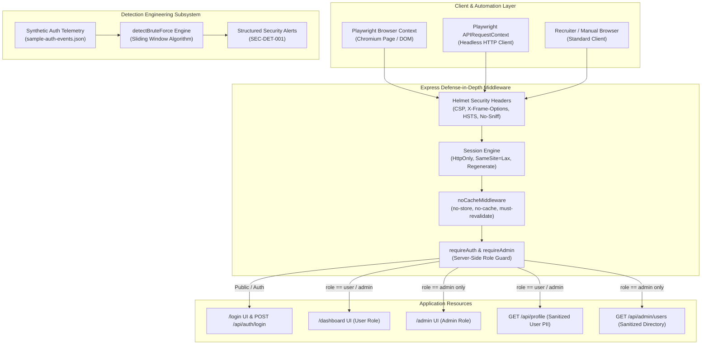
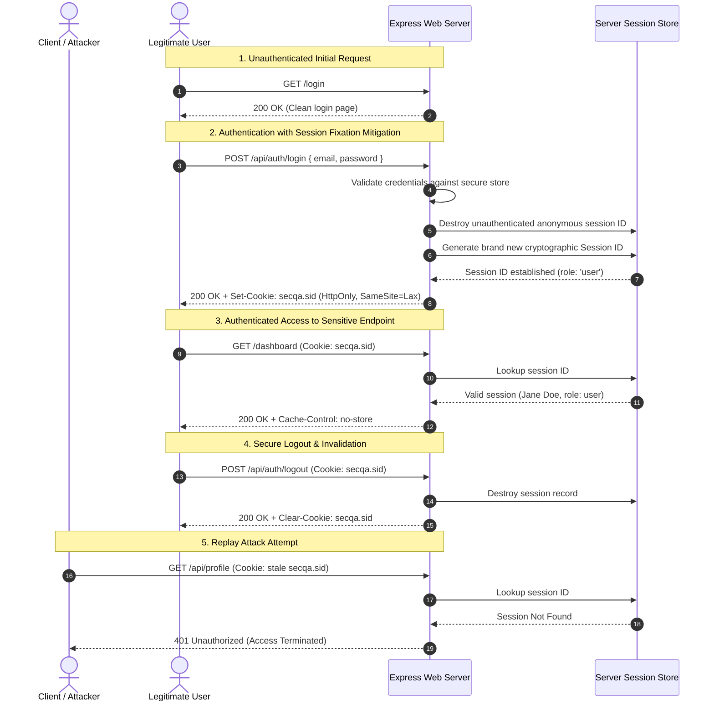
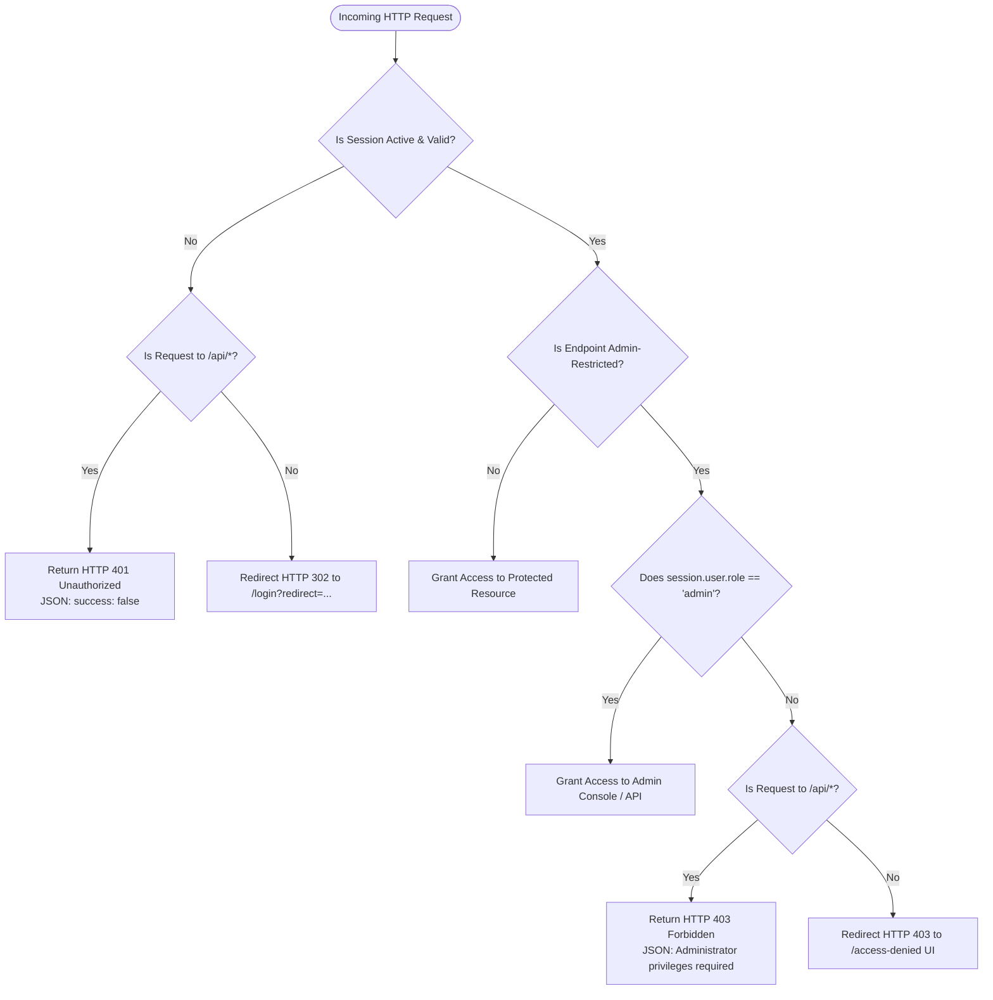
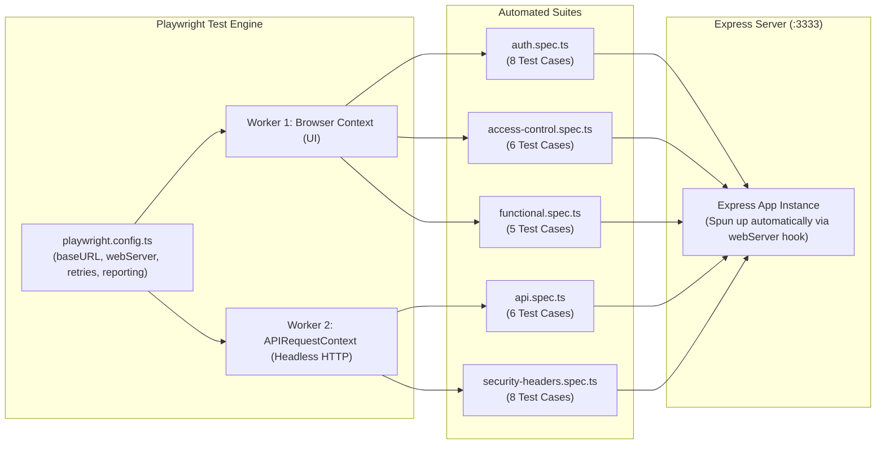
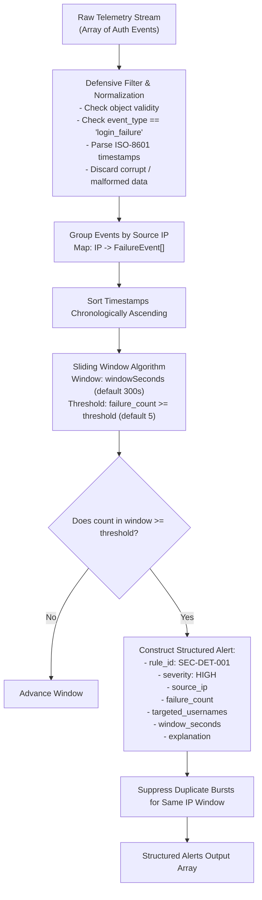

# System & Security Architecture

This document details the architectural design of the **Playwright Security QA Automation Lab**, covering application architecture, security middleware defense layers, test automation architecture, and detection engineering pipelines.

---

## 1. High-Level Architecture Overview

The lab is engineered as an end-to-end security verification ecosystem comprising three tightly coupled subsystems:

1. **Target Web Application & REST API (`src/app.ts`)**: An Express.js application designed with role-based access control (RBAC), session management, and defense-in-depth HTTP security headers.
2. **Automated Security QA Test Harness (`tests/`)**: A TypeScript test suite executing both headless browser workflows and direct API protocol interactions via Playwright Test.
3. **Detection Engineering Engine (`detection/`)**: An independent analytical module demonstrating SIEM-like sliding-window detection for credential brute-force attacks against synthetic authentication logs.

---

## 2. Target Application Security Layers

### 2.1 Defense-in-Depth Security Headers (Helmet)

The Express application registers `helmet()` at the root middleware stack, enforcing baseline protective headers across all responses:

| Header | Configured Value | Threat Vector Mitigated | Scope & Senior AppSec Note |
|---|---|---|---|
| `Content-Security-Policy` | `default-src 'self'; object-src 'none'; frame-ancestors 'none'; base-uri 'self'` | Cross-Site Scripting (XSS), Data Injection, UI Redress | Prevents browser from loading scripts, plugins, or frames from untrusted origins. Does not replace server-side input sanitization. |
| `X-Frame-Options` | `DENY` | Clickjacking / UI Redress (Legacy Browsers) | Ensures older clients that do not parse CSP `frame-ancestors` refuse iframe embedding. |
| `X-Content-Type-Options` | `nosniff` | MIME-Confusion / Content Sniffing Attacks | Forces browsers to strictly adhere to declared MIME types, preventing executable code disguised as images or text. |
| `Referrer-Policy` | `strict-origin-when-cross-origin` | Credential & URI Path Leakage | Truncates sensitive path parameters from the HTTP `Referer` header when navigating cross-domain. |
| `Strict-Transport-Security` | `max-age=31536000; includeSubDomains` | Man-in-the-Middle (MITM) & SSL Strip | Enforces persistent HTTPS communication in production environments. |
| `X-Powered-By` | *Removed / Suppressed* | Technology Fingerprinting | Removes obvious server signature (`Express`), forcing automated scanners to work harder. |

### 2.2 Session Security & Fixation Defense

Session handling is implemented via `express-session` configured with strict security flags:

- **Cookie Name**: `secqa.sid` (Non-default name to avoid framework identification).
- **`httpOnly: true`**: Prohibits client-side scripts from reading the cookie via `document.cookie`, mitigating XSS session theft.
- **`sameSite: 'lax'`**: Enforces cross-site request forgery (CSRF) mitigation during top-level cross-domain navigations.
- **Session Regeneration (`req.session.regenerate`)**: Invoked immediately upon successful credential validation in `POST /api/auth/login`. This invalidates the pre-authentication session identifier, mitigating **Session Fixation attacks**.
- **Explicit Invalidation (`req.session.destroy`)**: Triggered on `POST /api/auth/logout`, destroying the server-side session object and instructing the browser to clear `secqa.sid`.

### 2.3 Server-Side Role-Based Access Control (RBAC)

Authorization is enforced exclusively at the server level via express middleware (`requireAuth` and `requireAdmin`), never relying solely on frontend element hiding:

---

## 3. Playwright Test Architecture

Playwright Test acts as both a functional browser automation tool and an API integration testing framework:

### 3.1 Dual-Paradigm Testing Strategy

1. **Browser UI Layer (`page`)**:
   - Uses accessible, resilient locators (`getByTestId`, `getByRole`).
   - Asserts visual state changes, form validation states, DOM updates, and redirect URLs.
   - Inspects live browser context cookies via `page.context().cookies()`.
2. **Protocol & API Layer (`request`)**:
   - Leverages `APIRequestContext` for direct HTTP request/response validation.
   - Asserts exact status codes (`400`, `401`, `403`, `404`), JSON schema integrity, and raw HTTP header values.
   - Performs negative security tests (e.g., SQL injection strings, XSS vectors, parameter tampering) without browser UI overhead.

---

## 4. Detection Engineering Architecture

The detection subsystem (`detection/detect-bruteforce.js`) models how a Security Operations Center (SOC) or SIEM correlates raw authentication logs to surface automated attacks:

### 4.1 Sliding-Window Algorithm Complexity

- **Time Complexity**: $\mathcal{O}(N \log N)$ where $N$ is the number of failure events per IP (due to sorting), followed by an $\mathcal{O}(N)$ two-pointer linear scan.
- **Space Complexity**: $\mathcal{O}(N)$ storage to group events by IP in a hash map.
- **Deduplication**: Once an IP triggers an alert for an active burst, `windowTriggered` prevents duplicate alert spam for subsequent events within that burst.
