# Scope, Known Limitations & Production Roadmap

This document outlines the operational boundaries, threat model scope, and production roadmap for the **Playwright Security QA Automation Lab**. Being candid and explicit about limitations is the hallmark of a senior application security engineer.

---

## 1. Project Scope & Threat Model Boundaries

### 1.1 Educational & Demonstration Purpose
This repository is engineered specifically as a **Security QA & Playwright Automation Lab** for technical demonstration, portfolio evaluation, and candidate interview walkthroughs.
- All credentials, accounts, and telemetry events are **synthetic** and strictly development-only.
- The web server binds locally to `http://127.0.0.1:3333` and must never be exposed directly to the public Internet without production TLS and identity boundaries.

### 1.2 Automated Security QA vs Full Penetration Testing
Automated Playwright and API tests provide continuous **hardening regression verification** and **contract enforcement**. However:
- Automated tests verify known patterns and configured security baselines.
- They **do not replace manual penetration testing**, code audits, or human threat modeling.
- Security QA tests confirm that controls (RBAC, headers, cookies, input rejection) remain intact across code deployments; they do not prove the absence of zero-day vulnerabilities.

---

## 2. Technical Limitations of the Demo Application

| Area | Current Implementation | Production Requirement | Senior Engineering Explanation |
|---|---|---|---|
| **Credential Storage** | Plaintext comparisons in `src/app.ts` (`foundUser.password !== password`) | Argon2id or bcrypt hashing with per-user cryptographic salts | Plaintext credentials in code or memory are unacceptable in production. In this demo, plaintext is used strictly to enable transparent debugging and test readability. |
| **Session Persistence** | Default in-memory session store (`express-session` MemoryStore) | Distributed Redis or PostgreSQL session store with TTL | In-memory session storage leaks memory under high load, does not persist across server restarts, and cannot scale across multiple horizontal containers. |
| **Transport Layer** | HTTP (`http://127.0.0.1:3333`) with `secure: false` cookie flag in local test mode | Strict HTTPS/TLS 1.3 with `secure: true` and HSTS preload | In local test environments without TLS certificates, `secure: true` causes browsers to drop session cookies. In production, HTTPS is mandatory. |
| **Rate Limiting** | Evaluated offline via detection rule (`detection/`) | Active in-line rate limiting via Redis token bucket (e.g. `express-rate-limit`) or Cloudflare WAF | The demo app lets requests reach the server so the detection rule can observe failure logs. In production, active rate limiting blocks brute-force in real time. |
| **CSRF Tokens** | SameSite=Lax cookie attribute baseline | Synchronizer token pattern (CSRF tokens) or custom headers for state-changing POST requests | `SameSite=Lax` provides strong baseline CSRF mitigation for modern browsers, but defense-in-depth requires explicit anti-CSRF tokens for legacy browser support. |

---

## 3. Detection Engineering Limitations (`SEC-DET-001`)

The custom detection rule is a focused demonstration of event correlation and threshold analysis. In real enterprise environments, several threat factors require additional complexity:

### 3.1 Network Address Translation (NAT) & Shared Egress
- **The Problem**: Corporate offices, mobile carriers, and VPN gateways route thousands of distinct users through a single public IP address.
- **Limitation**: A rigid threshold of 5 failures in 5 minutes will trigger false positive alerts during shift changes or when multiple legitimate employees mistype passwords.
- **Production Tuning**: Incorporate unique-username variance metrics ($U_{\text{fail}} > 3$) and calculate failure rate relative to total outbound traffic from that IP.

### 3.2 Distributed Credential Stuffing & Botnets (MITRE ATT&CK T1110.004)
- **The Problem**: Sophisticated adversaries use residential proxy networks to distribute attempts across thousands of distinct IPs (e.g. 1 attempt per IP every 24 hours).
- **Limitation**: Single-source-IP detection (`failuresByIp`) will never fire because no single IP reaches the threshold.
- **Production Tuning**: Complement IP-centric rules with **User-Centric rules** (tracking failed attempts against the *same account identifier* across all IPs) and global anomaly detection.

### 3.3 Low-and-Slow Credential Guessing
- **The Problem**: Attackers intentionally space login attempts across intervals longer than the detection window (e.g. 1 attempt every 15 minutes).
- **Limitation**: The sliding window drops events older than `windowSeconds` (300s), allowing low-and-slow attacks to pass undetected.
- **Production Tuning**: Multi-tier detection windows (e.g., Short window: 5 attempts / 5 mins; Long window: 15 attempts / 24 hours).

---

## 4. Production Hardening Roadmap

If this architecture were promoted to an enterprise production service, the following milestones would be implemented:

```mermaid
flowchart LR
    subgraph Phase1["Phase 1: Persistence & Cryptography"]
        P1_1["Argon2id Password Hashing"]
        P1_2["PostgreSQL / Prisma ORM"]
        P1_3["Redis Distributed Session Store"]
    end

    subgraph Phase2["Phase 2: In-Line Defense"]
        P2_1["Redis Token-Bucket Rate Limiter"]
        P2_2["WAF Integration (Cloudflare / AWS WAF)"]
        P2_3["CAPTCHA / Proof-of-Work Step-Up"]
    end

    subgraph Phase3["Phase 3: Observability & SIEM"]
        P3_1["Structured JSON Logging (Pino / Winston)"]
        P3_2["OpenTelemetry Distributed Tracing"]
        P3_3["Elasticsearch / Splunk Forwarder"]
    end

    Phase1 --> Phase2 --> Phase3
```

1. **Enterprise Identity & Multi-Factor Authentication**:
   - Integrate WebAuthn / FIDO2 hardware tokens and TOTP MFA.
   - OIDC / OAuth 2.0 integration (Okta, Keycloak, or Microsoft Entra ID).
2. **Real-Time Active Blocking**:
   - Connect detection alerts to an automated response playbook (SOAR) to temporarily block abusive IPs at the perimeter firewall.
3. **Continuous Security Scanning in CI/CD**:
   - Add SAST (Semgrep, SonarQube) and dependency vulnerability scanning (`npm audit`, Trivy, Snyk).
   - Add DAST (OWASP ZAP) runs scheduled in parallel with Playwright suites.
