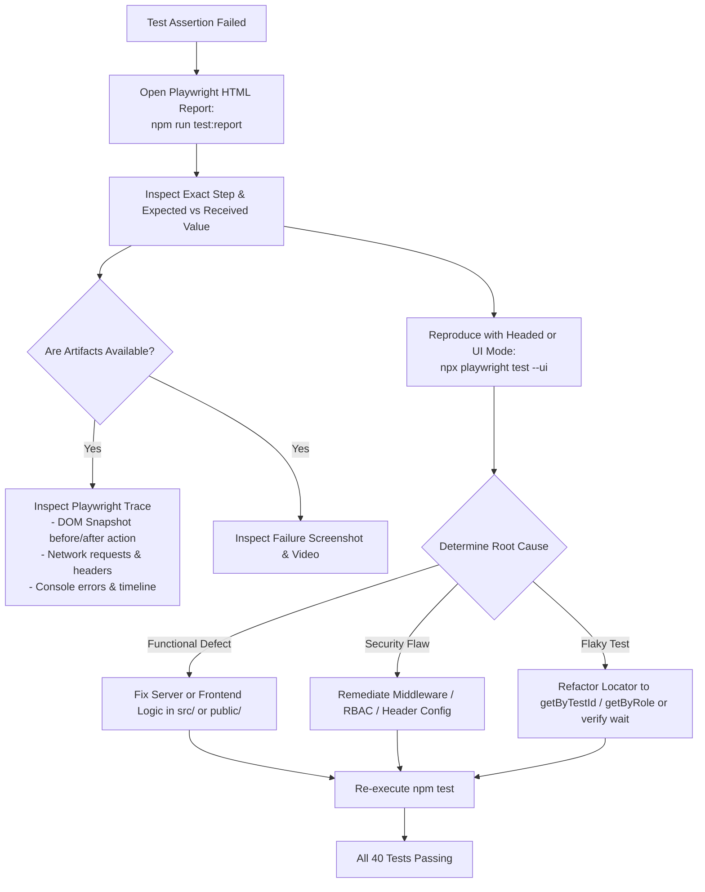

# Security QA Test Plan & Verification Matrix

This comprehensive test plan specifies the test strategy, execution methods, and detailed verification matrix for the **Playwright Security QA Automation Lab**.

---

## 1. Test Strategy & Objectives

The goal of this test suite is to validate that functional business logic and application security controls operate harmoniously without regression.

### 1.1 Scope of Testing

| Testing Domain | Focus Area | Framework / Tool | Execution Mode |
|---|---|---|---|
| **Authentication & Session** | Form login, credential validation, enumeration defense, session flags, logout invalidation | Playwright Test (Chromium) | Headless UI & API Context |
| **Role-Based Access Control** | Least privilege enforcement, horizontal/vertical privilege escalation defenses, direct URL tampering | Playwright Test | Browser DOM & REST API |
| **Functional & Regression** | Form pattern checks, UI state updates, interactive API tools, multi-cycle idempotency | Playwright Test | Browser DOM |
| **REST API Contracts** | HTTP status semantics, payload sanitization, sensitive data leakage, negative payload rejection | Playwright APIRequestContext | Headless HTTP Protocol |
| **Security Headers & Cookies** | CSP, X-Frame-Options, X-Content-Type-Options, Referrer-Policy, Cache-Control, Cookie scope | Playwright Test & API Context | HTTP Response Header Inspection |
| **Detection Engineering** | Slotted brute-force detection, threshold evaluation, multi-IP independence, telemetry resilience | Node.js Test Runner (`node:test`) | In-Memory Unit / Integration |

---

## 2. Test Execution Matrix

### 2.1 Authentication & Session Management (`tests/auth.spec.ts`)

| Test ID | Test Title & Objective | Threat / OWASP Category | Playwright Methods Used | Expected Result | Failure Meaning & Debugging |
|---|---|---|---|---|---|
| **TC-AUTH-001** | Successful login with valid user credentials | OWASP A07:2021 Identification & Auth | `page.goto()`, `getByTestId()`, `page.context().cookies()` | Navigates to `/dashboard`, displays user pill, assigns `secqa.sid` with `HttpOnly` and `SameSite=Lax`. | **Auth Broken**: Server rejected valid credentials or failed to issue cookie. Inspect Express session secret and cookie config. |
| **TC-AUTH-002** | Successful login with admin credentials | OWASP A07:2021 Identification & Auth | `getByTestId().fill()`, `getByTestId().click()`, `toBeVisible()` | Navigates to `/dashboard`, renders `ADMIN` badge, displays privileged `Admin Portal` link. | **RBAC UI Regression**: Admin role not detected or link hidden. Check `user.role` assignment in `src/app.ts`. |
| **TC-AUTH-003** | Login rejection with invalid password | OWASP A07:2021 Identification & Auth | `getByTestId().fill()`, `toContainText()`, `toBeUndefined()` | Stays on `/login`, displays generic alert, no session cookie created. | **False Acceptance / Fixation**: Bad password accepted or unauthenticated cookie issued. Check login verification logic. |
| **TC-AUTH-004** | User enumeration defense (non-existent email) | OWASP A07:2021 Identification & Auth | `getByTestId().fill()`, `toHaveText()` | Displays exact same error message: `Invalid email or password.` | **PII / Account Harvesting**: Different error message returned (e.g. "Email not found"), allowing attackers to map valid users. |
| **TC-AUTH-005** | Client-side required field validation | Quality / Form Integrity | `getByTestId().click()`, `toContainText()` | Prevents submission, renders localized field error labels under blank fields. | **Client Validation Regression**: Blank form submitted to backend. Inspect `public/app.js` submit listener. |
| **TC-AUTH-006** | User logout destroys session & cookie | OWASP A07:2021 Session Management | `getByTestId().click()`, `toHaveURL()`, `toBeUndefined()` | Redirects to `/login`, `secqa.sid` destroyed in context, subsequent `/dashboard` access redirects to login. | **Session Leak / Lingering Cookie**: Session remained active or cookie was not cleared. Inspect `req.session.destroy` handler. |
| **TC-AUTH-007** | Direct unauthenticated access redirects to login | OWASP A01:2021 Broken Access Control | `page.goto()`, `toHaveURL()` | Server intercepts request, redirects to `/login?redirect=%2Fdashboard`. | **Missing Auth Guard**: Unauthenticated user allowed into protected dashboard. Check `requireAuth` middleware. |
| **TC-AUTH-008** | Post-logout session invalidation prevents replay | OWASP A07:2021 Session Invalidation | `request.post()`, `request.get()` | Replaying captured post-logout cookie header against `/api/profile` returns `401 Unauthorized`. | **Critical Session Fixation / Replay**: Session was not removed from server memory. Check session store destruction logic. |

---

### 2.2 Role-Based Access Control (`tests/access-control.spec.ts`)

| Test ID | Test Title & Objective | Threat / OWASP Category | Playwright Methods Used | Expected Result | Failure Meaning & Debugging |
|---|---|---|---|---|---|
| **TC-RBAC-001** | Standard user denied access to Admin UI | OWASP A01:2021 Broken Access Control | `page.goto('/admin')`, `response.status()`, `toHaveURL()` | Server responds with HTTP `403 Forbidden`, redirects to `/access-denied` page. Admin link omitted from DOM. | **Privilege Escalation**: Standard user viewed privileged admin console. Check `requireAdmin` middleware. |
| **TC-RBAC-002** | Standard user denied access to Admin REST API | OWASP A01:2021 Broken Access Control | `request.get('/api/admin/users')`, `status()` | Server responds with HTTP `403 Forbidden` and `{ success: false, error: "Forbidden..." }`. | **Missing Function Level Access Control (MFLAC)**: Backend API trusted client without checking user role. |
| **TC-RBAC-003** | Administrator granted access to Admin UI & API | Functional & Privilege Validation | `page.getByTestId().click()`, `request.get()`, `toHaveCount()` | Admin navigates to `/admin`, views 2 directory rows, API returns HTTP `200` with 2 user objects. | **RBAC Denial of Service**: Valid administrator wrongly blocked from authorized resources. Check role check condition. |
| **TC-RBAC-004** | Unauthenticated request to Admin API returns 401 | OWASP A01:2021 Broken Access Control | `request.get('/api/admin/users')`, `status()` | Responds with HTTP `401 Unauthorized` (not 403 or 200). | **Semantic Status Code Confusion**: Unauthenticated requests should return 401, while unauthorized requests return 403. |
| **TC-RBAC-005** | Unauthenticated request to Profile API returns 401 | OWASP A01:2021 Broken Access Control | `request.get('/api/profile')`, `status()` | Responds with HTTP `401 Unauthorized` with JSON error payload. | **Data Leakage**: Profile data exposed without authentication. Verify `requireAuth` is mounted on `/api/profile`. |
| **TC-RBAC-006** | Direct URL tampering cannot bypass authorization | OWASP A01:2021 Forced Browsing | `page.goto('/admin')`, `request().redirectedFrom()` | Unauthenticated client forced to `/login`. | **Forced Browsing Vulnerability**: Server failed to intercept unauthenticated request to privileged route. |

---

### 2.3 Functional & UI Regression (`tests/functional.spec.ts`)

| Test ID | Test Title & Objective | QA Engineering Principle | Playwright Methods Used | Expected Result | Failure Meaning & Debugging |
|---|---|---|---|---|---|
| **TC-FUNC-001** | Page title, brand navigation, & footer | Functional Regression & UX | `toHaveTitle()`, `toHaveAttribute()`, `toBeVisible()` | Title matches regex, brand link points to `/`, footer disclaimer is rendered. | **Template Regression**: Layout header/footer broken or missing links. Inspect `renderLayout` in `src/app.ts`. |
| **TC-FUNC-002** | Form validation: email pattern & recovery | Input Validation & Error Clearing | `fill()`, `click()`, `toContainText()`, `toHaveURL()` | Invalid email triggers format error; correcting it allows immediate successful form submission. | **Form Lockout**: Validation state persisted even after valid email entered. Inspect validation listeners in `public/app.js`. |
| **TC-FUNC-003** | Dashboard components & Profile API inspector | Interactive Component Testing | `click()`, `toBeHidden()`, `toBeVisible()`, `toContainText()` | Clicking "Verify Profile API" dynamically fetches JSON and renders formatted output box. | **Client Fetch Failure**: Dynamic DOM script failed to fetch `/api/profile`. Check network tab and console errors. |
| **TC-FUNC-004** | Admin portal table rendering & columns | Data Grid / Table Validation | `locator('th')`, `toContainText()`, `toHaveCount()` | Table renders 6 defined column headers (`ID`, `Name`, `Email`, `Role`, `Department`, `Created`) and 2 rows. | **UI Data Binding Regression**: Admin table did not render database records accurately. |
| **TC-FUNC-005** | Repeated execution idempotency | Idempotency / No State Pollution | Loop (2 cycles): `login() -> verify() -> logout()` | Consecutive logins and logouts succeed without state contamination or race conditions. | **State Pollution / Flaky Execution**: Lingering cookies, session locks, or timing issues causing secondary runs to fail. |

---

### 2.4 REST API Security & Contracts (`tests/api.spec.ts`)

| Test ID | Test Title & Objective | Threat / AppSec Principle | Playwright Methods Used | Expected Result | Failure Meaning & Debugging |
|---|---|---|---|---|---|
| **TC-API-001** | Unauthenticated session status | Contract / Protocol Integrity | `request.get('/api/auth/status')`, `json()` | Returns HTTP `200` with `{ authenticated: false }`. | **API Schema Mismatch**: Status endpoint threw 500 or returned invalid schema. |
| **TC-API-002** | Profile API schema integrity & secret exclusion | OWASP A02:2021 Cryptographic / PII Leaks | `request.get('/api/profile')`, `toBeUndefined()` | Returns profile fields (`id`, `email`, `role`, `department`), `password` and `hash` fields are strictly `undefined`. | **Critical Credential Leakage**: Database record was serialized directly without stripping password hash. |
| **TC-API-003** | Admin users directory schema validation | OWASP A02:2021 Sensitive Data Exposure | `request.get('/api/admin/users')`, `toBeUndefined()` | Returns count and user array. Every user record in array lacks password/hash. | **Batch PII Exposure**: Administrative user dump leaked credentials. Check sanitization mapping in route handler. |
| **TC-API-004** | Negative Test: Missing payload fields | Defensive Input Handling | `request.post()`, `status()`, `json()` | Empty body, missing email, or missing password returns HTTP `400 Bad Request`. | **Unhandled Input Crash**: Missing fields caused unhandled exception (500) instead of client error (400). |
| **TC-API-005** | Negative Test: SQLi & XSS payload injection | OWASP A03:2021 Injection | `request.post()`, loop over payloads, `status()` | Malicious inputs (`' OR '1'='1`, `<script>`) rejected with HTTP `401`, no 500 crashes or script reflection. | **Injection / Unhandled Exception**: Server attempted unsanitized execution or crashed with unhandled syntax error. |
| **TC-API-006** | Negative Test: Non-existent route handling | Information Disclosure / 404 | `request.get('/api/unknown')`, `status()`, `json()` | Returns structured JSON HTTP `404 Not Found` without framework stack traces. | **Default Route Leakage**: Missing 404 handler or Express default HTML error page leaked. |

---

### 2.5 Security Headers & Hardening (`tests/security-headers.spec.ts`)

| Test ID | Test Title & Objective | Security Hardening Standard | Playwright Methods Used | Expected Result | Failure Meaning & Debugging |
|---|---|---|---|---|---|
| **TC-SEC-001** | CSP enforcement on sensitive routes | OWASP Secure Headers / XSS Defense | `page.goto()`, `response.headers()['content-security-policy']` | Contains `default-src 'self'`, `object-src 'none'`, `frame-ancestors 'none'`, `base-uri 'self'`. | **XSS Mitigation Regression**: Helmet CSP was disabled or misconfigured. Check `helmet()` declaration in `src/app.ts`. |
| **TC-SEC-002** | Clickjacking mitigation via X-Frame-Options | OWASP Clickjacking Defense | `headers['x-frame-options']` | Header value equals `DENY`. | **Clickjacking Risk**: Application can be framed in an external site for UI redressing. |
| **TC-SEC-003** | MIME-type sniffing mitigation | OWASP Content Sniffing | `headers['x-content-type-options']` | Header value equals `nosniff`. | **MIME Confusion Vulnerability**: Browser may execute non-executable files if content sniffing is enabled. |
| **TC-SEC-004** | Referrer-Policy origin isolation | Privacy & Token Exposure | `headers['referrer-policy']` | Header value equals `strict-origin-when-cross-origin`. | **Referer Token Leakage**: Sensitive URL parameters leaked in HTTP Referer when outbound links are clicked. |
| **TC-SEC-005** | Server technology banner suppression | Fingerprinting / Reconnaissance | `headers['x-powered-by']`, `toBeUndefined()` | `X-Powered-By` header is completely absent from HTML and API responses. | **Reconnaissance Exposure**: Server explicitly advertises `Express`, easing attacker vulnerability mapping. |
| **TC-SEC-006** | Cache-Control on sensitive endpoints | OWASP A05:2021 Sensitive Caching | `request.get()`, `headers['cache-control']` | Contains `no-store, no-cache, must-revalidate` and `Pragma: no-cache`. | **Sensitive PII Stored on Disk**: Downstream proxies or shared browser caches will store authenticated dashboard/PII. |
| **TC-SEC-007** | Session cookie attributes | OWASP Session Security | `page.context().cookies()` | `httpOnly: true`, `sameSite: 'Lax'`, `path: '/'`, `expires > now`. | **Cookie Theft Risk**: Cookie accessible via `document.cookie` or prone to CSRF exploitation. |
| **TC-SEC-008** | Error handling suppresses stack traces | Information Disclosure (A05) | `request.get()`, `text()`, `not.toContain()` | Error response does not contain `node_modules`, `/home/`, or file paths. | **Internal Path Disclosure**: Server stack trace returned to untrusted client, aiding attacker recon. |

---

### 2.6 Detection Engineering Unit & Integration Tests (`detection/detection.test.js`)

| Test ID | Test Title & Objective | Detection Engineering Rationale | Test Mechanism | Expected Result | Failure Meaning & Debugging |
|---|---|---|---|---|---|
| **TC-DET-001** | Threshold boundary exact trigger | Rule Precision (Threshold Boundary) | Node.js Test Runner (`node:test`) | Exactly 5 failures within window triggers exactly 1 alert with correct rule ID, IP, and count. | **Off-by-One Threshold Error**: Rule failed to trigger at `count >= threshold`. Check window counter. |
| **TC-DET-002** | Below-threshold negative test | Rule Sensitivity (False Positive Avoidance) | Boundary check: 4 failures (threshold - 1) | Zero alerts emitted. | **High False Positive Rate**: Alert fired prematurely before threshold was met. |
| **TC-DET-003** | Multi-IP independent tracking | IP Partitioning / No Crosstalk | Mixed stream: IP A (5 fails), IP B (2 fails), IP C (6 fails) | Exactly 2 alerts emitted (for IP A and IP C); IP B disregarded. | **State Bleed Across IPs**: Event counts aggregated across distinct IPs. Check Map grouping. |
| **TC-DET-004** | Ignores login_success & interleaving | Event Type Filtering | 5 successes followed by 2 failures | Zero alerts emitted. | **Event Filter Failure**: Successful logins counted as failures, causing massive false positives. |
| **TC-DET-005** | Sliding window time enforcement | Sliding Window Expiration | 5 failures spread over 50 minutes (window = 5 min) | Zero alerts emitted. | **Low-and-Slow False Positive**: Old events outside sliding window not pruned. Check window two-pointer shrink. |
| **TC-DET-006** | Resilient to corrupt & malformed data | Telemetry Ingestion Robustness | `null`, `{ missing fields }`, malformed date strings | Function handles all corrupt items gracefully without throwing unhandled exceptions. | **Pipeline Crash / DoS**: Unsanitized SIEM log crashed detection service. Check input validation. |
| **TC-DET-007** | Integration: Evaluates sample events JSON | Dataset Integration Test | Reads `detection/sample-auth-events.json` | Produces 1 structured alert for attacker IP `198.51.100.42` targeting 5 usernames. | **Integration Regression**: Rule engine failed to process standard production-like JSON telemetry. |

---

## 3. Test Execution Commands

```bash
# 1. Run complete automated test suite (Detection + Playwright E2E)
npm test

# 2. Run only Detection Engineering unit tests
npm run test:detection

# 3. Run all Playwright browser & API tests
npm run test:e2e

# 4. Run targeted test suites
npm run test:auth
npm run test:access-control
npm run test:functional
npm run test:api
npm run test:security-headers

# 5. Interactive UI Mode (Debugging & visual inspection)
npm run test:e2e:ui

# 6. Headed browser mode
npm run test:e2e:headed

# 7. Generate & inspect HTML Report
npm run test:report

# 8. Typecheck & lint validation
npm run typecheck
```

---

## 4. Failure Triage & Debugging Procedure

If a test fails during CI/CD or local execution:


